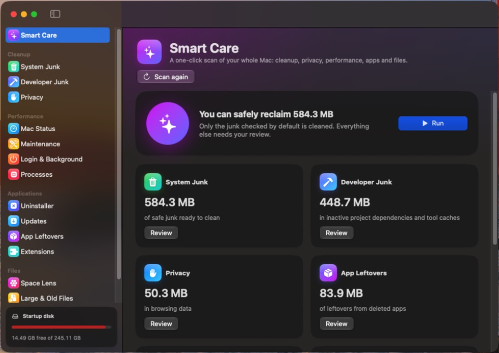
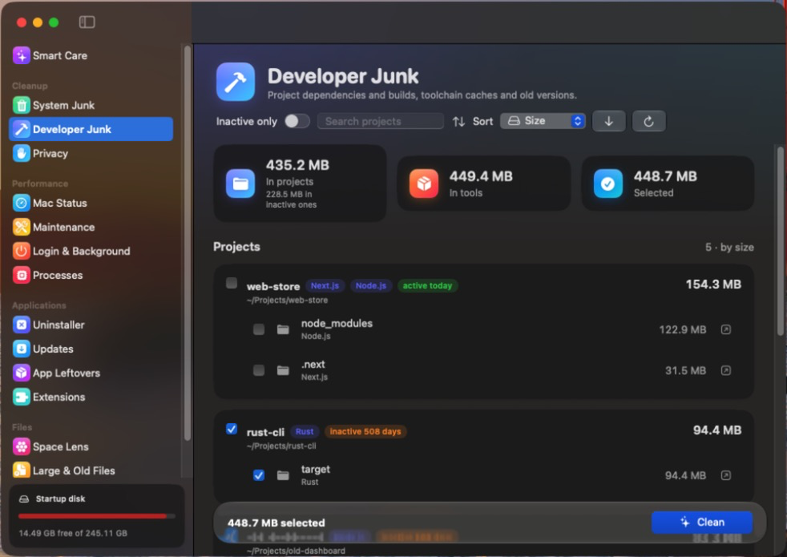
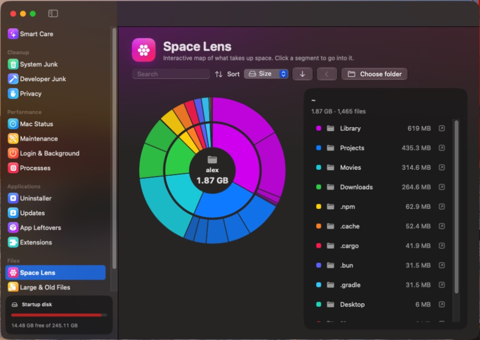
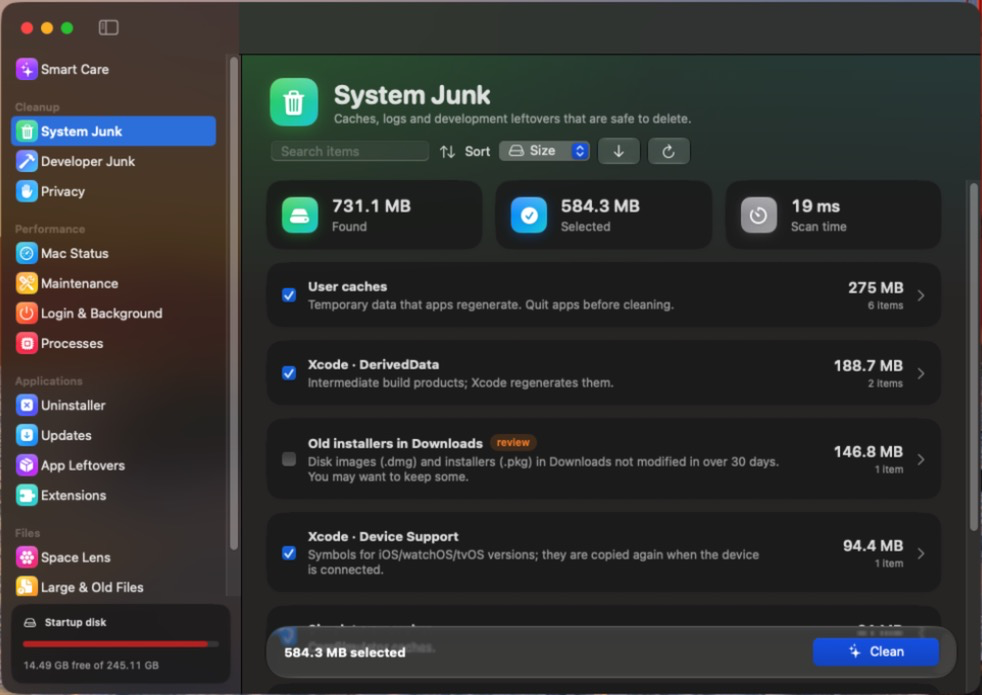
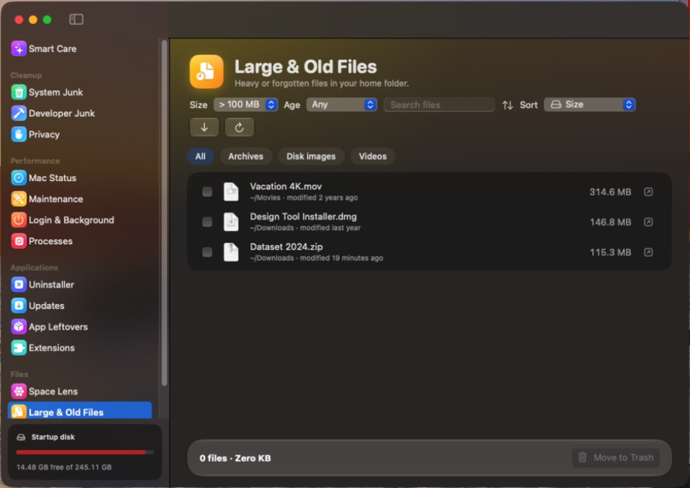

<p align="center">
  
</p>

<h1 align="center">MacCleaner</h1>

<p align="center">
  A lightweight macOS cleaner: a Rust core, a thin native SwiftUI interface and a tiny background monitor.<br>
  ~6 MB on disk · 0 MB when closed · ~2 MB background monitor · English and Spanish.
</p>

<p align="center">
  
</p>

## Why

Popular commercial cleaners ship hundreds of megabytes of frameworks and keep several processes
resident all the time (menu bar app, health monitor, privileged helper). MacCleaner is a clean-room
take on the same idea, designed to stay out of the way:

| | Typical commercial cleaner | MacCleaner |
|---|---|---|
| Size on disk | ~400 MB | ~6 MB |
| Memory when closed | ~100 MB (4 processes) | 0 MB (1.8 MB with the optional monitor) |
| Memory while scanning | — | 3–6 MB in the Rust core |
| Privileged helper always running | yes | no — admin tasks ask once, when needed |

## Features

| Area | Modules |
|---|---|
| **Smart Care** | Runs every analysis in sequence and cleans only what is safe by default. |
| **Cleanup** | System junk (caches, logs, Xcode, simulators, Mail downloads, iOS backups, broken preferences, old disk images…), developer junk, privacy (browser history, cookies, caches; recent items). |
| **Developer junk** | `node_modules`, `target`, `.next`, `Pods`, `.venv`, `.gradle`, `.dart_tool`, `.build`… — only when the file that generates them sits next to them (`package.json`, `Cargo.toml`, `Podfile`…), pre-selected only for projects idle for 30+ days. Plus npm, Bun, pnpm, Cargo, Go, Gradle and `~/.cache` caches, old Node (nvm) and Rust (rustup) toolchains, `brew cleanup` and Docker image/build-cache pruning. |
| **Performance** | Live Mac status, maintenance tasks (DNS, RAM, Spotlight, Launch Services, fonts, Quick Look), login and background items, top processes. |
| **Applications** | Uninstaller with leftovers, Sparkle updates, leftovers of deleted apps, extensions. |
| **Files** | Space Lens (interactive sunburst), large and old files, duplicates. |

Every list can be searched and sorted. The interface follows the device language (English or
Spanish — see [the Spanish UI](docs/screenshots/developer-junk-es.png)).

<p align="center">
  
  
</p>
<p align="center">
  
  
</p>

## Safety

- Everything goes to the **Trash** (recoverable), except emptying the Trash itself, which is
  explicit and never pre-selected.
- The core re-validates every path before acting: only direct entries of known junk locations,
  recognised project artifacts or user files under your home folder — never `..`, symlink targets
  or protected folders.
- Files inside packages (Photos and Music libraries, apps, Final Cut/Logic projects…) are never
  listed or deleted.
- Caches of apps that are currently open are shown but not pre-selected.
- Disk analyses run **one at a time** with low CPU and I/O priority, use fewer threads when memory
  is tight and stop if memory pressure becomes critical, so they never compete with the app you
  are using (e.g. a video call).

## Install

1. Download `MacCleaner-<version>-macOS-arm64.zip` from
   [Releases](https://github.com/gadgrandez/maccleaner/releases) and unzip it.
2. Move `MacCleaner.app` to `/Applications`.
3. The build is not notarized by Apple, so the first launch is blocked by Gatekeeper. Either
   right-click the app → **Open**, or go to **System Settings → Privacy & Security → Open Anyway**.
   Alternatively: `xattr -dr com.apple.quarantine /Applications/MacCleaner.app`.
4. Optional but recommended: grant **Full Disk Access** (the sidebar shows a button) so it can
   analyse Desktop, Documents, Downloads, the Trash and Mail without permission prompts.

Requirements: macOS 14 or later on Apple silicon. Liquid Glass is used on macOS 26+.

## Build from source

See [docs/BUILDING.md](docs/BUILDING.md). In short:

```bash
./scripts/build-app.sh          # → build/MacCleaner.app
./scripts/package-release.sh    # → dist/MacCleaner-<version>-macOS-arm64.zip
cargo test --workspace          # core tests
```

## Architecture

```
gui/            SwiftUI app (Swift Package). Talks to the core through a C API that exchanges JSON.
crates/core     Rust core: rules, parallel scanner (getattrlistbulk), validated cleaning, apps,
                performance, privacy, files, developer junk, system metrics, launchd.
crates/ffi      Static library with the C API (include/maccleaner*.h, see docs/ffi-contracts.md).
crates/monitor  Optional background monitor (LaunchAgent, low priority, ~2 MB).
scripts/        Build, packaging, icon, demo data and screenshot tools.
```

- **Scanner**: `openat` + `getattrlistbulk`, no symlink following, no volume crossing, fixed
  128 KB buffer per thread, up to 8 threads; idle threads receive subdirectories from busy ones,
  so a single huge folder is still scanned in parallel (≈2 M files in ~10 s with a ~4 MB peak).
- **Monitor**: checks disk space, memory pressure, swap and accumulated junk with cheap syscalls
  once a minute; the daily junk scan runs in a short-lived child process. Notifications are posted
  by the app itself in an ephemeral mode.
- **Admin tasks**: no permanent root helper; administrator tasks are grouped into a single system
  authorization dialog.

Out of scope on purpose: malware scanning (needs proprietary signatures) and stripping languages
or architectures from apps (it breaks code signatures).

## Screenshots

The screenshots in this README were generated from a fake home folder
(`scripts/make-demo-home.sh`) with `scripts/snapshot.sh`, so they contain no personal data.
